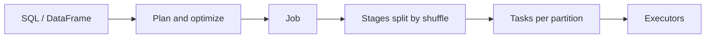

# Spark Architecture

Source: local code at `~/projects/spark`
Last reviewed: 2026-08-22

## AI Summary

> Spark SQL is a query compiler on top of a distributed execution engine.



| Piece | Remember this |
|---|---|
| Driver | Plans and coordinates the application |
| Cluster manager | Gives Spark machines and resources |
| Executor | Processes partitions on worker machines |
| Catalyst | Analyzes and optimizes SQL plans |
| RDD | Lower-level partition and lineage model |

For a slow query:

```text
explain("formatted") -> SQL tab -> stages -> tasks -> executors
```

Look for large scans, shuffles, skew, spill, and unexpected joins.

### Drill down

- [[Spark SQL Query Lifecycle|SQL lifecycle]]
- [[Spark Distributed Execution|Driver and executors]]
- [[Spark Execution Terms|Execution terms]]
- [[Spark RDD|RDD]]
- [[Spark AQE|AQE]]
- [[Spark Repository Map|Code map]]

## Things I Learned

<!-- User-authored. -->
